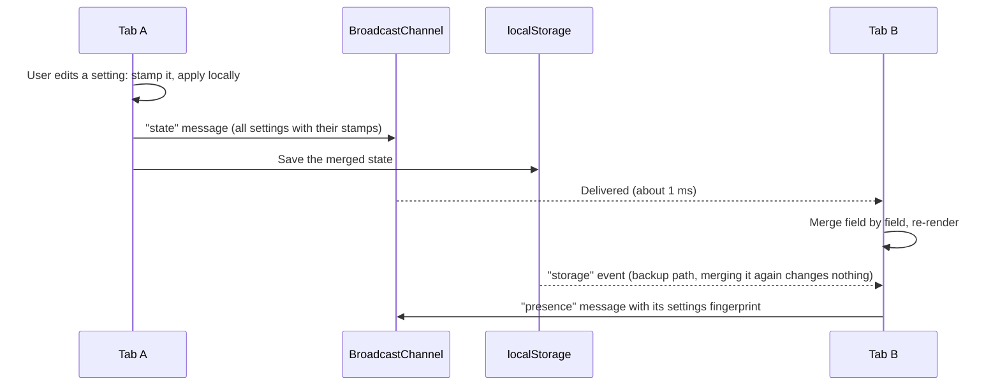

# Multi-Tab Settings Synchronization

GDG Tech Wildcard Entry: Frontend Development, Task 1.

A TypeScript web app that keeps user preferences in sync across every open tab of the browser.
Change the theme, language or text size in one tab and every other tab follows within a few
milliseconds. Preferences survive closing all tabs, a new tab never flashes the wrong theme, and
simultaneous edits from different tabs always settle on the same value everywhere.

**Live demo:** https://yashrajkanawade357.github.io/GDG-Project-Submission/ (open it in two or
more tabs)

## Features

- **Preferences:** dark-mode toggle, language selector (English, हिन्दी, Español, Français,
  Deutsch, 日本語) and a text-size slider (12–24 px) that scales the whole interface.
- **Real-time sync** over `BroadcastChannel`, with the `storage` event as a second delivery path.
  Measured at about 1–3 ms between tabs, against a 100 ms target.
- **Persistence** in `localStorage`, restored when the app is opened again.
- **No flash on load:** a tiny inline script applies the saved theme, size and language before
  the first paint.
- **Deterministic conflict resolution:** each setting is versioned with a hybrid logical clock,
  and ties are broken by tab id. All tabs converge regardless of message order, duplicates or loss.
- **Sync monitor** built into the page:
  - live latency (last, average, p95, max, a sparkline, and the share delivered within 100 ms)
  - a list of open tabs, each with a fingerprint of its settings, showing whether they agree
  - a conflict drill that makes every tab write at the same instant
  - an activity log showing where each change came from
- No UI framework and no runtime dependencies: about 12 kB of gzipped JavaScript.

## Running it

Requires Node.js 20.19 or newer (developed on Node 24) and npm.

```bash
npm install
npm run dev
```

Then open the printed URL (http://localhost:5173 by default) in **two or more tabs**, or press
**Open another tab** in the app.

| Command           | What it does                                       |
| ----------------- | -------------------------------------------------- |
| `npm run dev`     | Development server with hot reload                 |
| `npm test`        | Runs the 66 unit and multi-tab simulation tests    |
| `npm run build`   | Type-checks, then builds a static site into `dist/` |
| `npm run preview` | Serves the production build locally                |

The build is a plain static site with relative asset paths, so it can be hosted anywhere. Every
push to `main` runs the tests, builds, and deploys to GitHub Pages
(`.github/workflows/deploy.yml`).

### Things to try

1. Open three tabs side by side and drag the text-size slider in one. The other two follow the
   thumb, and their latency panels fill up with samples.
2. Press **Run drill**. Every tab writes a different random text size at the same moment. Each tab
   lists the three proposals, marks the same winner, and the open-tabs list shows identical
   fingerprints.
3. Switch to dark mode, close every tab, and open the app again. It comes back dark, with no white
   frame first.

## How synchronization works



**Two delivery paths.** `BroadcastChannel` is the fast path. It hands a copy of each message
directly to every other same-origin tab without going through storage. Every save to
`localStorage` also fires a `storage` event in the other tabs. That path is slower, but it works
even where `BroadcastChannel` is missing, and it catches anything the channel missed. A tab may
receive the same change twice, which is harmless (see below). The tab broadcasts before saving,
so the faster message normally arrives first.

**Messages carry full state.** The state is three small fields, so every message carries all of
them with their versions instead of a diff. A lost message is repaired by the next one, and no
message depends on another having arrived.

**Tab lifecycle.**

- **Opening.** The boot script paints the saved preferences. The app loads the stored state and
  broadcasts `hello` with it. Every open tab merges that and replies with its own state, so a tab
  that read an out-of-date copy from storage catches up straight away.
- **Hidden, frozen or back/forward cache.** When the tab becomes visible again (`visibilitychange`,
  `pageshow`), it re-reads storage and re-announces itself.
- **Closing.** On `pagehide` the tab broadcasts `bye`, and the others remove it from their list.

## Conflict resolution

Each setting is stored as its own register: `{ value, stamp }`, where `stamp = { t, tab }`.

- **`t` is a hybrid logical clock.** For a new edit, `t = max(Date.now(), highest t seen + 1)`. It
  follows real time, so of two simultaneous edits the one made later wins. It never goes
  backwards, even if the system clock is adjusted. Because it is always greater than any stamp
  the tab has seen, an edit made after receiving another tab's change always wins over that change.
- **`tab` breaks ties.** If two tabs edit in the same millisecond, the larger tab id (a random UUID
  per page load) wins. Stamps are therefore totally ordered, and every tab independently picks the
  same winner.
- **Merge = keep the larger stamp, per field.** This makes the merge commutative, associative and
  idempotent: a state-based CRDT (a map of last-writer-wins registers). Tabs can receive updates in
  any order, several times, or late, and they still end with identical state.
- **Per-field, not per-document.** If one tab turns on dark mode while another changes the
  language, both changes survive. Only edits to the same setting compete.

| Situation                                      | Outcome                                     |
| ---------------------------------------------- | ------------------------------------------- |
| Tab A sets 14 px at t=1000, Tab B sets 22 px at t=1003 | 22 px everywhere (later edit)        |
| Both write in the same millisecond (t=1000)    | The tab with the larger id wins, everywhere |
| B edits after seeing A's change, but B's clock is behind | B wins: its stamp is `max(now, seen + 1)` |
| A changes the theme while B changes the language | Both changes are kept                     |
| A message is lost or delivered twice           | The next message or the `storage` event repairs it; duplicates change nothing |

**Storage write races.** `localStorage` has no cross-tab transactions. If two tabs save at the same
instant, the slower write can overwrite the newer state. Every save fires a `storage` event in the
other tabs, so the tabs holding the newer state see the stored copy go backwards and rewrite it.
The stored copy always ends up with the latest value without needing locks.

### Alternatives considered

- **Wall-clock last-writer-wins.** Simple, but two edits in the same millisecond, or a clock that
  jumps backwards, give different results in different tabs.
- **Plain Lamport clock.** Deterministic, but it ignores real time, so a tab that has seen more
  updates can beat an edit the user made later in another tab.
- **A leader tab or a SharedWorker as the single source of truth.** That works too, but it needs
  leader election and failover. Storage has to survive closing every tab anyway, so a
  peer-to-peer CRDT with `localStorage` as the durable copy is simpler and has no single point of
  failure.

## No flash of the wrong theme

`index.html` contains a small inline script in `<head>`. It runs synchronously, before the
stylesheet and the body. It reads the saved state, validates each value, and sets `data-theme`,
the root font size and `lang` on `<html>`. The first frame the browser paints is therefore
already correct. With nothing saved, the theme follows the operating system's
`prefers-color-scheme`. The interface text stays hidden until the app has rendered it in the
right language, while the background is already the correct colour. Colour transitions are only
enabled after the first frame, so opening a tab never animates. `tests/boot.test.ts` runs that
script against real stored data to make sure it accepts exactly the values the app accepts.

## Measured latency

Latency is measured from the moment the sending tab posts a change to the moment the receiving
tab has merged it and updated the page. The monitor shows it live.

Measured in a Chromium-based browser, with three tabs open and 64 edits made by dragging the slider:

| Last    | Average | p95     | Max     | Within 100 ms |
| ------- | ------- | ------- | ------- | ------------- |
| 3.10 ms | 1.29 ms | 2.40 ms | 4.10 ms | 100 %         |

## Tests

66 tests run with Vitest and jsdom (`npm test`):

- **Clock:** monotonic under clock jumps, causality, ties.
- **Merge:** property checks over 300 random document triples confirming commutativity,
  associativity and idempotence; per-field behaviour; tie-breaking.
- **Validation:** corrupted storage, foreign versions, out-of-range values, bad stamps, malformed
  messages.
- **Boot script:** run against saved, missing and corrupted data.
- **Multi-tab simulations:** an in-memory stand-in for `BroadcastChannel` lets each test decide the
  order in which messages arrive and whether they arrive at all. Covered: propagation, latency
  measurement, persistence after every tab closes, storage-race repair, catch-up of a stale tab,
  every conflict case in the table above, presence, and the conflict drill. Randomized runs make
  400 edits across four tabs with skewed clocks, random interleavings, arbitrary reordering and
  30–50 % message loss. They check that every tab ends with the same state and that it equals the
  newest write.

## Project structure

```
index.html                Page shell and the inline boot script
src/
  main.ts                 Entry point
  styles.css              Theme tokens (light and dark), layout
  sync/
    types.ts              Settings, Stamp and document types
    schema.ts             Defaults, validation, (de)serialization, fingerprints
    clock.ts              Hybrid logical clock and stamp ordering
    merge.ts              Per-field last-writer-wins merge
    store.ts              One tab's replica: local edits, merging, storage repair
    persistence.ts        localStorage access (safe when storage is blocked)
    transport.ts          Message types, validation, BroadcastChannel transport
    tabSync.ts            Wires a replica to the other tabs; presence, latency, drill
    latency.ts            Rolling latency statistics
    index.ts              Browser wiring (storage events, page lifecycle)
  ui/
    app.ts                Rendering and controls
    i18n.ts               Translations for all six languages
tests/                    Vitest suites and the in-memory multi-tab harness
```

The sync engine (`src/sync`) does not touch the DOM, except for the browser wiring in `index.ts`.
The UI only calls `set()` and re-renders from events, which keeps the sync logic easy to test in
isolation.

## Edge cases handled

- **Corrupted or foreign data in `localStorage`:** validated field by field; bad fields fall back to
  defaults.
- **Storage blocked or full (private modes, disabled site data):** the app keeps working in memory,
  and tabs still sync over `BroadcastChannel`.
- **`BroadcastChannel` unavailable:** tabs still converge through the `storage` event.
- **Duplicated tabs:** the tab id is generated per page load, not kept in `sessionStorage` (which a
  duplicated tab copies), so two tabs never share an id and ties stay deterministic.
- **Background tabs:** messages are still delivered. Only the presence heartbeat is throttled by
  the browser, and the timeouts allow for that.
- **The system clock moving backwards:** handled by the hybrid clock.

## Limitations

- Sync covers tabs of the same browser profile and origin. There is no server, by design.
- A tab that crashes without sending `bye` stays in the open-tabs list for up to 150 seconds.
- Latency compares the high-resolution clocks of two tabs converted to epoch time. Sub-millisecond
  values are approximate.
