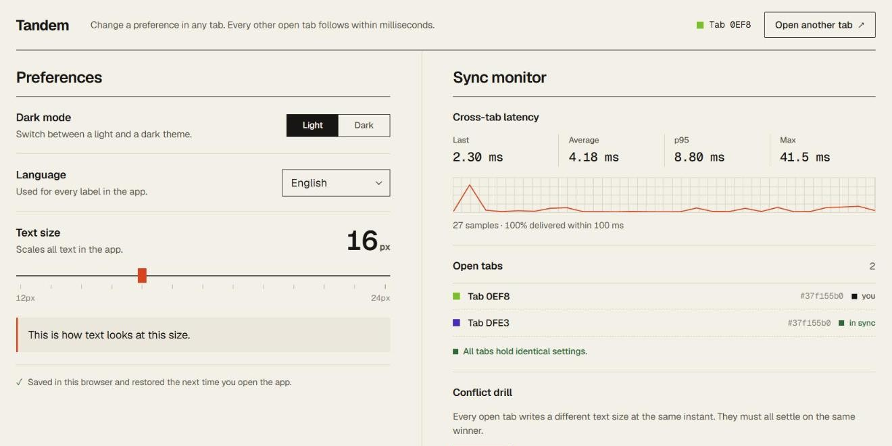
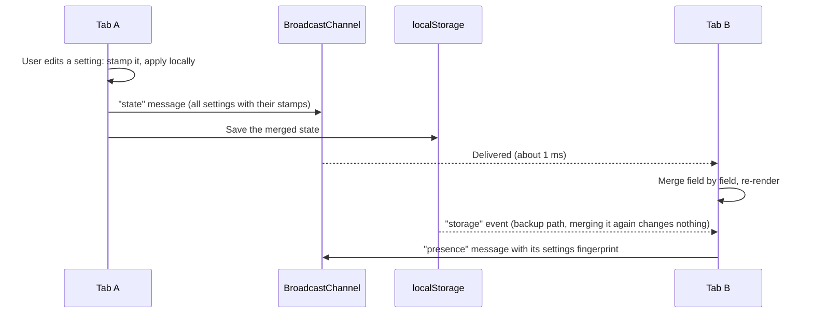
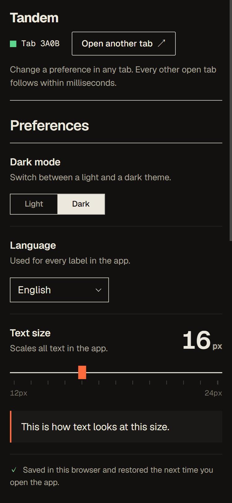
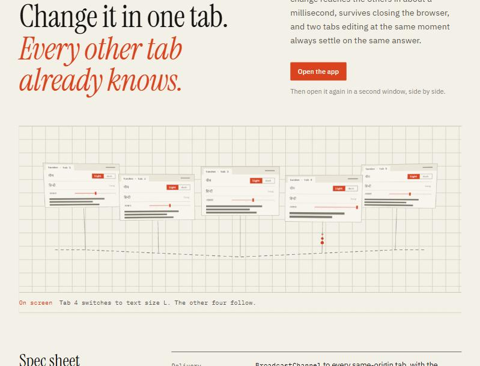

<div align="center">

# Tandem

**Preferences that stay in step across every open browser tab.**

<sub>GDG Tech Wildcard Entry &nbsp;·&nbsp; Frontend Development &nbsp;·&nbsp; Task 1: Multi-Tab Settings Synchronization</sub>

<br />

[**Landing page**](https://gdg-project-submission.vercel.app) &nbsp;&nbsp;|&nbsp;&nbsp;
[**Open the app**](https://gdg-project-submission.vercel.app/app/) &nbsp;&nbsp;|&nbsp;&nbsp;
[How it works](#how-synchronization-works) &nbsp;&nbsp;|&nbsp;&nbsp;
[Conflict resolution](#conflict-resolution)

<br />



</div>

<br />

```diff
+ Cross-tab sync      1.29 ms average, 4.10 ms worst case            (brief: under 100 ms)
+ Conflicts           deterministic, per setting: hybrid clock + tab id
+ Persistence         localStorage, applied before the first paint, so no wrong-theme flash
+ Languages           English, हिन्दी, Español, Français, Deutsch, 日本語
+ Tests               67 passing, including randomized four-tab runs with lost messages
+ App bundle          ~12 kB gzipped, TypeScript, no framework, no runtime dependencies
```

> [!TIP]
> Open the app in **two windows side by side**. Drag the text-size slider in one and the other
> follows the thumb. Then press <kbd>Run drill</kbd>: every tab writes a different size at the same
> instant, and all of them settle on the same winner.

<br />

## Contents

- [What the brief asks for, and where it is](#what-the-brief-asks-for-and-where-it-is)
- [Running it](#running-it)
- [How synchronization works](#how-synchronization-works)
- [Conflict resolution](#conflict-resolution)
- [No flash of the wrong theme](#no-flash-of-the-wrong-theme)
- [Measured latency](#measured-latency)
- [Tests](#tests)
- [Project structure](#project-structure)
- [Edge cases and limitations](#edge-cases-and-limitations)

<br />

## What the brief asks for, and where it is

| Requirement | How Tandem does it | Code |
| :-- | :-- | :-- |
| Dark-mode toggle, language selector, font-size slider | <kbd>Light</kbd> <kbd>Dark</kbd> switch, six languages, 12–24 px slider that scales the whole UI | `src/ui/app.ts`, `src/ui/i18n.ts` |
| Real-time sync, target under 100 ms | `BroadcastChannel` fast path plus the `storage` event as a backup. Measured at **1.29 ms** average | `src/sync/tabSync.ts`, `src/sync/transport.ts` |
| Persistence after every tab closes | Every change is saved to `localStorage` and read back on open | `src/sync/store.ts`, `src/sync/persistence.ts` |
| New tabs never show the wrong theme | Inline script in `<head>` applies saved settings before the first frame | `app/index.html` |
| Deterministic conflict resolution | Per-setting last-writer-wins with a hybrid logical clock; the tab id breaks ties | `src/sync/clock.ts`, `src/sync/merge.ts` |
| Repository, README, technical explanation, deployment | This repository, this file, the sections below, and the [live site](https://gdg-project-submission.vercel.app) | – |

<details>
<summary><b>Evaluation criteria, mapped</b></summary>

<br />

| Criterion | Weight | Where to look |
| :-- | :-: | :-- |
| Cross-tab synchronization and latency | 30% | [How synchronization works](#how-synchronization-works), [Measured latency](#measured-latency), the live monitor in the app |
| Conflict resolution and consistency | 25% | [Conflict resolution](#conflict-resolution), <kbd>Run drill</kbd> in the app, randomized convergence tests |
| Persistence and initialization | 20% | [No flash of the wrong theme](#no-flash-of-the-wrong-theme), `tests/boot.test.ts` |
| Code quality and architecture | 15% | [Project structure](#project-structure), strict TypeScript, 67 tests, CI |
| UI/UX and responsiveness | 10% | Desktop and phone layouts, both themes, six languages |

</details>

<br />

## Running it

> [!NOTE]
> Requires **Node.js 20.19 or newer** (developed on Node 24) and npm.

```bash
npm install
npm run dev
```

| Page | Local URL | Live URL |
| :-- | :-- | :-- |
| Landing page | `http://localhost:5173/` | https://gdg-project-submission.vercel.app |
| App | `http://localhost:5173/app/` | https://gdg-project-submission.vercel.app/app/ |

| Command | What it does |
| :-- | :-- |
| `npm run dev` | Development server with hot reload |
| `npm test` | Runs the 67 unit and multi-tab simulation tests |
| `npm run build` | Type-checks, then builds a static site into `dist/` |
| `npm run preview` | Serves the production build locally |

The build is a plain static site with relative asset paths, so it can be hosted anywhere. The live
site is on **Vercel**, which redeploys on every push to `main`. **GitHub Actions** runs the tests
and the build on every push (`.github/workflows/ci.yml`).

### Things to try

1. Open three tabs side by side and drag the text-size slider in one. The other two follow the
   thumb, and their latency panels fill up with samples.
2. Press <kbd>Run drill</kbd>. Every tab writes a different random text size at the same moment.
   Each tab lists the three proposals, marks the same winner, and the open-tabs list shows
   identical fingerprints.
3. Switch to <kbd>Dark</kbd>, close every tab, and open the app again. It comes back dark, with no
   white frame first.
4. Leave the landing page open while you do this. It follows the app's theme too.

<br />

## How synchronization works



```diff
@@ fast path @@
+ BroadcastChannel: a copy of each message goes straight to every other same-origin tab
@@ backup path @@
+ storage event: every localStorage save also notifies the other tabs
@@ order @@
+ broadcast first, then save, so the faster message normally arrives first
```

**Two delivery paths.** `BroadcastChannel` hands a copy of each message directly to every other
same-origin tab without going through storage. Every save to `localStorage` also fires a `storage`
event in the other tabs. That path is slower, but it works even where `BroadcastChannel` is
missing, and it catches anything the channel missed. A tab may receive the same change twice,
which is harmless (see below).

**Messages carry full state.** The state is three small fields, so every message carries all of
them with their versions instead of a diff. A lost message is repaired by the next one, and no
message depends on another having arrived.

**Tab lifecycle.**

| Moment | What happens |
| :-- | :-- |
| Opening | The boot script paints the saved preferences. The app loads the stored state and broadcasts `hello` with it. Every open tab merges that and replies with its own state, so a tab that read an out-of-date copy catches up straight away. |
| Hidden, frozen, back/forward cache | When the tab becomes visible again (`visibilitychange`, `pageshow`), it re-reads storage and re-announces itself. |
| Closing | On `pagehide` the tab broadcasts `bye`, and the others remove it from their list. |

<br />

## Conflict resolution

Each setting is stored as its own register:

```ts
{ value, stamp: { t, tab } }   // t = hybrid logical clock, tab = random id per page load
```

- **`t` is a hybrid logical clock.** For a new edit, `t = max(Date.now(), highest t seen + 1)`. It
  follows real time, so of two simultaneous edits the one made later wins. It never goes
  backwards, even if the system clock is adjusted. Because it is always greater than any stamp the
  tab has seen, an edit made after receiving another tab's change always wins over that change.
- **`tab` breaks ties.** If two tabs edit in the same millisecond, the larger tab id wins. Stamps
  are therefore totally ordered, and every tab picks the same winner on its own.
- **Merge = keep the larger stamp, per field.** This makes the merge commutative, associative and
  idempotent: a state-based CRDT (a map of last-writer-wins registers). Tabs can receive updates in
  any order, several times, or late, and they still end up with identical state.
- **Per field, not per document.** If one tab turns on dark mode while another changes the
  language, both changes survive. Only edits to the same setting compete.

```diff
  Tab A sets 14 px at t=1000   |   Tab B sets 22 px at t=1003
+ 22 px everywhere: the later edit wins

  Tab A and Tab B both write at t=1000
+ the tab with the larger id wins, in every tab

  Tab B edits after seeing A's change, but B's clock is behind
+ B wins: its stamp is max(now, seen + 1)

  Tab A changes the theme while Tab B changes the language
+ both changes are kept

  A message is lost or delivered twice
+ the next message or the storage event repairs it; duplicates change nothing
```

> [!IMPORTANT]
> **Storage write races.** `localStorage` has no cross-tab transactions. If two tabs save at the
> same instant, the slower write can overwrite the newer state. Every save fires a `storage` event
> in the other tabs, so a tab holding newer state sees the stored copy go backwards and rewrites
> it. The stored copy always ends up with the latest value, with no locks.

<details>
<summary><b>Alternatives considered</b></summary>

<br />

```diff
- Wall-clock last-writer-wins
!   two edits in the same millisecond, or a clock jumping back, give different results per tab

- Plain Lamport clock
!   deterministic, but ignores real time: a busier tab can beat a later edit made elsewhere

- Leader tab or SharedWorker as the single source of truth
!   works, but needs leader election and failover, and storage must survive every tab closing anyway

+ Chosen: peer-to-peer CRDT with localStorage as the durable copy
+   no coordinator, no single point of failure, provably convergent
```

</details>

<br />

## No flash of the wrong theme

`app/index.html` contains a small inline script in `<head>`. It runs synchronously, before the
stylesheet and the body. It reads the saved state, validates each value, and sets `data-theme`,
the root font size and `lang` on `<html>`, so the first frame the browser paints is already
correct.

- With nothing saved, the theme follows the operating system's `prefers-color-scheme`.
- Interface text stays hidden until it has been rendered in the right language. The background is
  already the right colour by then.
- Colour transitions switch on only after the first frame, so opening a tab never animates.
- `tests/boot.test.ts` runs the real script against stored data to make sure it accepts exactly
  the values the app accepts.

<br />

## Measured latency

Measured from the moment the sending tab posts a change to the moment the receiving tab has merged
it and updated the page. The app's monitor shows these numbers live.

<sub>Chromium-based browser · three tabs open · 64 edits made by dragging the slider</sub>

| Last | Average | p95 | Max | Within 100 ms |
| :-: | :-: | :-: | :-: | :-: |
| `3.10 ms` | **`1.29 ms`** | `2.40 ms` | `4.10 ms` | **100 %** |

<br />

## Tests

**67 tests** run with Vitest and jsdom (`npm test`).

| Suite | What it checks |
| :-- | :-- |
| Clock | Monotonic under clock jumps, causality, ties |
| Merge | Property checks over 300 random document triples (commutative, associative, idempotent), per-field behaviour, tie-breaking |
| Validation | Corrupted storage, foreign versions, out-of-range values, bad stamps, malformed messages |
| Boot scripts | App and landing scripts run against saved, missing and corrupted data |
| Multi-tab simulations | Propagation, latency, persistence after every tab closes, storage-race repair, stale-tab catch-up, every conflict case above, presence, conflict drill |

The simulations use an in-memory stand-in for `BroadcastChannel`, so each test decides the order in
which messages arrive and whether they arrive at all. The randomized runs push hard:

```diff
+ 400 edits across 4 tabs, with skewed clocks and random interleavings
+ arbitrary reordering, plus 30-50 % of messages dropped
+ every run ends with identical state in all tabs, equal to the newest write
```

<br />

## Project structure

```
index.html                Landing page
app/index.html            App page shell and the inline boot script
src/
  main.ts                 App entry point
  theme.css               Shared colour tokens (light and dark), type, buttons
  styles.css              App layout
  landing/
    main.ts               Landing entry; follows the app's theme through storage events
    scene.ts              three.js scene: tab panels, broadcast bus, last-writer-wins pulses
    landing.css           Landing layout
  sync/
    types.ts              Settings, Stamp and document types
    schema.ts             Defaults, validation, (de)serialization, fingerprints
    clock.ts              Hybrid logical clock and stamp ordering
    merge.ts              Per-field last-writer-wins merge
    store.ts              One tab's replica: local edits, merging, storage repair
    persistence.ts        localStorage access (safe when storage is blocked)
    transport.ts          Message types, validation, BroadcastChannel transport
    tabSync.ts            Wires a replica to the other tabs; presence, latency, drill
    latency.ts            Rolling latency statistics
    index.ts              Browser wiring (storage events, page lifecycle)
  ui/
    app.ts                Rendering and controls
    i18n.ts               Translations for all six languages
tests/                    Vitest suites and the in-memory multi-tab harness
docs/screenshots/         Images used in this README
```

The sync engine (`src/sync`) never touches the DOM, apart from the browser wiring in `index.ts`.
The UI only calls `set()` and re-renders from events, which keeps the sync logic easy to test in
isolation.

<table>
<tr>
<td width="62%" valign="top">

**Stack**

| | |
| :-- | :-- |
| Language | TypeScript 7, strict mode |
| Build | Vite 8, two pages (landing and app) |
| Tests | Vitest 5 + jsdom |
| Landing scene | three.js, lazy-loaded |
| Hosting | Vercel |

<br />

**Look**

Paper and ink colours with a single vermilion accent, thin rules instead of cards and shadows.
The app uses **Geist** for text and headings and **Geist Mono** for numbers and ids (Noto Sans
Devanagari for Hindi). The landing page has its own editorial type: Instrument Serif and IBM Plex.

</td>
<td width="38%" valign="top">



</td>
</tr>
</table>

<br />

## Edge cases and limitations

```diff
+ Corrupted or foreign data in localStorage  ->  validated field by field, bad fields use defaults
+ Storage blocked or full (private modes)      ->  keeps working in memory, tabs still sync
+ BroadcastChannel unavailable                 ->  tabs still converge through the storage event
+ Duplicated tabs                              ->  tab id is per page load, never shared
+ Background tabs                              ->  messages still arrive; only the heartbeat is throttled
+ System clock moving backwards                ->  handled by the hybrid clock

- Sync covers one browser profile and origin; there is no server, by design
- A tab that crashes without saying bye stays in the open-tabs list for up to 150 s
- Sub-millisecond latency values are approximate (two tabs' clocks are compared)
```

<br />

<div align="center">



<sub>The landing page. Five tabs hang off one broadcast channel; changes travel between them and
simultaneous writes resolve to the same winner, using the app's own rules.</sub>

<br /><br />

<sub>Built by **Yashraj Kanawade** · 2026</sub>

</div>
